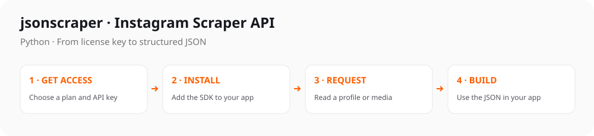

# Instagram Scraper API for Python

[](https://github.com/jsonscraper/instagram-api-python/tags)
[](#1-install)
[](https://github.com/jsonscraper/instagram-api-python/commits)
[](LICENSE)

[](https://www.postman.com/jsonscraper/workspace/jsonscraper/collection/52903714-fe84d353-0a19-431f-a39d-1c2640d96fb0)


Official Python client for the [jsonscraper Instagram Scraper API](https://jsonscraper.com/services/ig-scraper-api?utm_source=github&utm_medium=sdk&utm_campaign=instagram-api-python&utm_content=readme). **97 documented GET routes**, simple installation, configurable requests, working examples, and responses ready for your application.



**[Get an API key](https://jsonscraper.com/services/ig-scraper-api?utm_source=github&utm_medium=sdk&utm_campaign=instagram-api-python&utm_content=get_access) · [Current pricing](https://jsonscraper.com/services/ig-scraper-api?utm_source=github&utm_medium=sdk&utm_campaign=instagram-api-python&utm_content=pricing#pricing) · [Endpoint reference](docs/endpoints.md) · [Runnable examples](examples) · [Postman](https://www.postman.com/jsonscraper/workspace/jsonscraper/collection/52903714-fe84d353-0a19-431f-a39d-1c2640d96fb0)**

## Navigation

- [What you can build](#what-you-can-build)
- [Installation](#1-install)
- [License key and access](#2-get-api-access)
- [First request](#3-make-your-first-request)
- [Request examples](#more-request-examples)
- [Endpoint reference](docs/endpoints.md)
- [Configuration](#configuration)
- [Errors, pagination and caching](#errors-pagination-and-caching)
- [FAQ](#faq)
- [Development and releases](#development-and-releases)
- [Privacy](#privacy)

## What you can build

Read public profiles; retrieve media, reels and comments; explore hashtag/location/search routes; build analytics, monitoring and data integrations.

This repository contains the **Instagram SDK only**. It calls the hosted jsonscraper API; you do not need to maintain browser automation, platform sessions or a scraping server.

## 1. Install

Requirements: **Python 3.10+**.

```sh
python -m pip install "git+https://github.com/jsonscraper/instagram-api-python.git@v0.1.0"
```

The GitHub installation above works independently of package registry registration. A public PyPI/npm/Packagist listing is a separate release step; this README does not claim those listings already exist.

To develop from a checkout, clone this repository and install its dependencies. Python: `python -m pip install .`; Node.js: `npm ci`; PHP: `composer install`; Go: `go mod download`; Java: `mvn install`; C#: `dotnet build`.

## 2. Get API access

The SDK source uses the **MIT license**. Hosted API usage requires a separate **Instagram API license** with its own quota and validity period.

1. Open the [Instagram product page](https://jsonscraper.com/services/ig-scraper-api?utm_source=github&utm_medium=sdk&utm_campaign=instagram-api-python&utm_content=onboarding).
2. Check the current plans and follow **Get Access** to obtain your license key.
3. Save the key on your server as an environment variable:

```sh
export JSONSCRAPER_INSTAGRAM_LICENSE_KEY='your-license-key'
```

Current prices and limits are linked from the product page rather than copied into this README. That keeps the purchase information current. Do not commit your key or put it in browser/mobile frontend code.

## 3. Make your first request

```python
import os
from jsonscraper_instagram import Instagram, APIError

client = Instagram(os.environ["JSONSCRAPER_INSTAGRAM_LICENSE_KEY"], timeout=30, retries=1)
try:
    response = client.v1_user_by_username(username="apple", cache_timeout=60)
    if response.get("status") != "ok":
        raise RuntimeError("The API returned an application error")
    print(response["ig"])
except APIError as error:
    print(f"HTTP {error.status}; check your key, quota, or parameters")
```

**[Open the runnable version](examples/quickstart.py)**. The example uses a public account and a short server-side cache. You can replace the account with one relevant to your project. A licensed live request may consume quota.

The profile response follows this shape (shortened; fields can be absent or null):

```json
{
  "status": "ok",
  "ig": {
    "pk": "5821462185",
    "username": "apple",
    "is_private": false,
    "is_verified": true
  }
}
```

**[Response handling guide](docs/responses.md)** explains the envelope, application errors and identifiers. Profile responses were verified against the live API on 2026-10-25.

## Find the request you need

The [endpoint reference](docs/endpoints.md) lists every named SDK method, exact API path, query parameter and purpose. The [Postman collection](https://www.postman.com/jsonscraper/workspace/jsonscraper/collection/52903714-fe84d353-0a19-431f-a39d-1c2640d96fb0) contains current descriptions, parameter examples and endpoint groups.

Use the generic request method for newly added routes without waiting for an SDK release. Parameter names remain identical to Postman. For example, cache controls are always `cache_timeout`; platform IDs are passed as strings.

## More request examples

- [Read a media item](examples/media.py) — `GET /v1/media/by/code`.
- [Search public users](examples/search.py) — `GET /v1/search/users`.
- [Read a page of user media](examples/feed.py) — `GET /v1/user/medias/chunk`.

These examples make one request each. They never loop automatically through your quota. For feed pagination, inspect the returned cursor and `has_more`, then pass the cursor back to the same endpoint.

## Configuration

Default API base URL: **`https://ig.jsonscraper.com`**. Configure `base_url`, `timeout` (seconds), `retries`, `cache_timeout`. HTTPS is required except for explicit localhost test servers. Default timeout is 30 seconds.

Retries default to **0**; opt in to 0–5 retries for HTTP 429, 502, 503 and 504. Numeric `Retry-After` is respected up to 60 seconds; otherwise bounded exponential backoff applies. HTTP-date values use backoff. Retries may consume API quota, and total elapsed time can exceed one request timeout.

The configured license key is sent using the API's `license_key` query parameter. It overrides per-request attempts to supply a different key. Redirects are disabled, TLS verification stays enabled, and transport errors do not include request URLs. Keep credential-bearing URLs out of your application and reverse-proxy logs.

## Errors, pagination and caching

HTTP exceptions expose the status code and retry information. Transport failures have a credential-safe message. HTTP 200 alone is not application success: inspect `status` and any quota/product error fields. HTTP 403 can indicate an access restriction; 429 means you should wait or check the plan's limits.

Pagination is endpoint-specific. Pass a returned cursor unchanged to the next request, stop when `has_more` is false/0, and stop if a cursor repeats. Always set your own page/request budget. The SDK does not invent cursor fields or automatically spend your quota.

`cache_timeout=60` enables API-side caching for 60 seconds; `0` disables it. See the current product terms for quota treatment. The SDK does not cache responses locally.

Large IDs must remain strings in your application. Python preserves integer precision; JavaScript converts unsafe JSON integers to strings; PHP uses `JSON_BIGINT_AS_STRING`; Go provides `Decode()` with `json.Number`; Java returns response bytes for your chosen JSON library; C# exposes bytes and `JsonDocument`.

## FAQ

**Is this the official platform API?** This is the jsonscraper service SDK. jsonscraper is independent and is not affiliated with or endorsed by Instagram, Meta.

**Is the library free?** The SDK source is MIT-licensed. The hosted API requires a separate paid license. See [current plans and access](https://jsonscraper.com/services/ig-scraper-api?utm_source=github&utm_medium=sdk&utm_campaign=instagram-api-python&utm_content=faq).

**Does it work without a key?** A valid product license key is required for normal API requests. Never use a README example as a source of credentials.

**Can I use it in an existing application?** Yes. Install the package, configure the client, and call it from your server-side service. It does not require a web framework.

**Where do I ask for help?** For reproducible SDK bugs, open a [GitHub issue](https://github.com/jsonscraper/instagram-api-python/issues) with sanitized details. For plans, license questions and service support, use [jsonscraper contacts](https://jsonscraper.com/contacts?utm_source=github&utm_medium=sdk&utm_campaign=instagram-api-python&utm_content=support).

## Development and releases

```sh
python3 tests/contract.py
```

Tests run offline against a local/mock HTTP server and require no API key. A GitHub Actions template is included in `docs/github-actions.yml`; enabling it later requires `workflow` permission. No automatic workflow is enabled by this release.

See [CHANGELOG.md](CHANGELOG.md) for release notes. Package registry publishing is tracked separately from the public GitHub source release.

## Privacy

The SDK includes no installation, API usage or conversion telemetry. It sends requests only to the configured API endpoint. README website links carry UTM campaign parameters so jsonscraper can attribute website visits and actions to this repository; website tracking respects Do Not Track and Global Privacy Control. Purchase clicks are measured as intent, not confirmed payment.
